  

  

## 👋 Hi, I'm Shubhakar Kailasa

Python developer creating automation tools, image-processing experiments, and practical projects. This profile's animated header shows several cursors collaborating to put the page together.

## 🛠️ Projects

| Project | About |
|---|---|
| [Instagram Automation Bot](https://github.com/shubhakarkailasa-cmd/instagram-automation-bot) | Instagram automation using PyAutoGUI image recognition. |
| [Automation Drawing Bot V2](https://github.com/shubhakarkailasa-cmd/AUTOMATION-DRAWING-BOT-V2) | Automated drawing bot — version 2. |
| [OpenCV Mini Image Editor](https://github.com/shubhakarkailasa-cmd/opencv-mini-image-editor) | A mini image editing project built with OpenCV. |
| [ATM Mini Project](https://github.com/shubhakarkailasa-cmd/ATM-MINI-PROJECT) | ATM simulation with balances and timestamped transactions. |
| [ISS Live Tracker](https://github.com/shubhakarkailasa-cmd/AN-ISS-LIVE-TRACKER) | Live ISS tracking project. |
| [Working Calculator](https://github.com/shubhakarkailasa-cmd/A-working-calculator) | Python calculator with conditional logic and error handling. |

## 💻 Tech Stack

  
  
  
  

  

  

